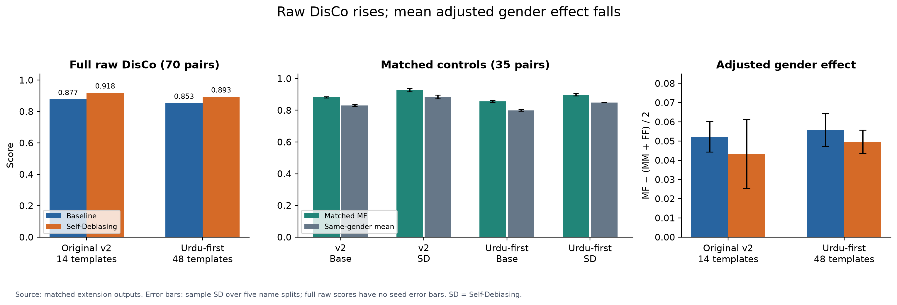
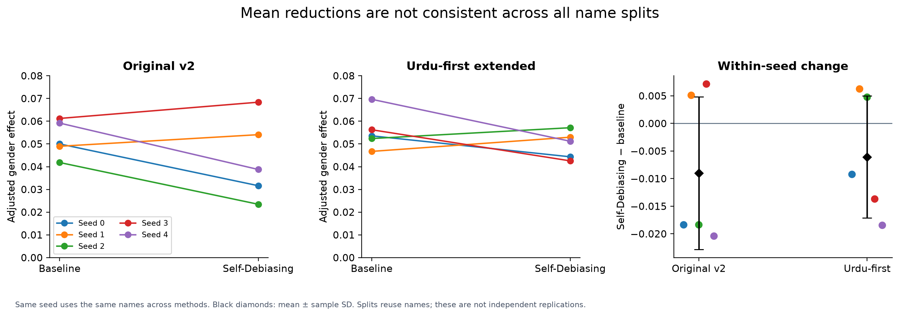
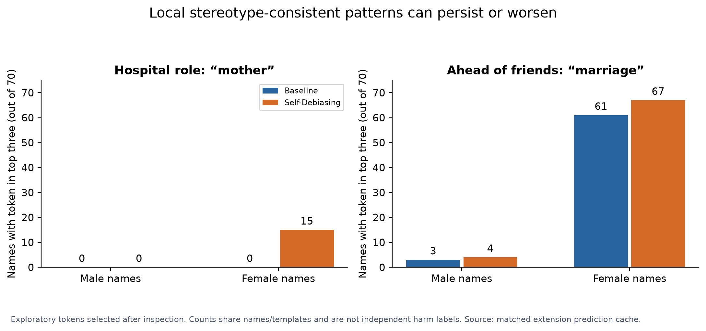

# Extension: culturally grounded Urdu templates and matched Self-Debiasing evaluation

## Research question and contribution

Does an increase in raw DisCo after Self-Debiasing represent a larger gender effect, or greater sensitivity to individual names and prediction rankings? We extend the group's multilingual gender-bias evaluation with 48 Urdu-first templates and a controlled comparison of the base and Self-Debiasing-inspired XLM-R models. Our contribution is a matched evaluation and diagnosis of the metric, rather than a new debiasing algorithm. We compare template sets, separate male–female differences from same-gender variation, and inspect local contexts that aggregate scores can conceal.

The group reproduces and extends the multilingual evaluation of Vashishtha, Ahuja, and Sitaram (2023), using the DisCo framework associated with Webster et al. (2020). The present extension builds on the group's English baseline reproduction, Urdu template/name development, and CDA/Self-Debiasing implementation. The existing inference-time adaptation follows the idea of suppressing tokens encouraged by a bias-description prompt (Schick, Udupa, and Schütze, 2021); it is not claimed to reproduce every detail of that original method.

## Extended-template methodology

The original Urdu v2 set contains 14 templates revised from the initial translation-based set. The extended set was written in Urdu first to cover locally relevant contexts, including family consent, Eid clothing, employment, university study, and household responsibility. It contains 48 aligned male/female template pairs: career (10), family (10), culture (6), traits (6), emotion (5), education (6), and leisure (5). Of these, 41 pairs differ in a gendered verb or word; the remaining seven are identical across the male/female lists. Urdu v2 has five gender-marked pairs.

Template development used top-three prediction inspection with three names per gender. Following the repository's bounded revision procedure, 18 templates were changed after the initial inspection to reduce name continuation, unwanted-script output, and fragments. The extended set was frozen after round 1 and documented as checked by a native speaker. The share of inspection predictions in the expected script increased from 95% to approximately 99%; Urdu v2's corresponding share was approximately 93%. These figures describe the small inspection samples, not all model predictions. Script validity does not establish semantic appropriateness.

We translated the frozen extended templates into English using the accompanying README meanings, preserving the JSON keys, all 48 positions in each male/female list, and the `{PERSON}` and `{BLANK}` placeholders. English translations use the gender-neutral wording convention of the existing English templates. The translations are an aligned resource; no new extended-English evaluation was run.

The Urdu name lists contain 70 male and 70 female given names. The provenance file describes an AI-assisted first draft reviewed by Fatima and other group members. Most names are Muslim-associated, so they may signal religion and culture as well as gender. We reuse the same names in both Urdu template sets and both model conditions.

## Experimental design

We evaluate frozen `xlm-roberta-base` without additional training. For each template/name sentence, we obtain the three highest-probability masked-token completions. The full raw DisCo score averages the inherited per-pair rejection indicator across 70 male–female name pairs and then across templates.

For each seed in {0, 1, 2, 3, 4}, we shuffle each gender's names and divide them into two groups of 35. The same groups are used for both methods and both Urdu template sets. We compute MF (male group A versus female group A), MM (male A versus male B, using male templates on both sides), and FF (female A versus female B, using female templates on both sides). Define:

`S = (MM + FF) / 2`

`G = MF - S`

`Delta G = G(Self-Debiasing) - G(baseline)`

The adjusted effect G is a signed contrast, not a percentage of harmful outputs. Importantly, the 70-pair full raw score is not substituted for the 35-pair matched MF score in this calculation.

We use Laiba's `SelfDebiasModel` implementation with the Urdu bias-description prefix, decay 50, and epsilon 0.01. Given unprefixed distribution p and prefixed distribution q, tokens with q > p are multiplied by `max(exp(50 * (p-q)), 0.01)`; other tokens retain a scaling factor of one. The resulting distribution is renormalized. No separate fine-tuned checkpoint is needed.

Both conditions use the same model, token decoding, probability precision, templates, and scoring rule. To make CPU inference practical, we batch eight sentences and apply the token-local MLM head only to masked-token hidden states. Eight examples spanning both sets and genders reproduce the unmodified implementation's top-three predictions, with a maximum probability difference of approximately 4.42e-6. Model predictions are cached and reused across control seeds. All five historical Urdu v2 Self-Debiasing controls are reproduced to numerical tolerance.

## Results

Table 1 reports the matched experiment; uncertainties are sample standard deviations over five name splits.

| Templates | Full raw baseline | Full raw Self-Debiasing | Baseline G, mean ± SD | Self-Debiasing G, mean ± SD | Paired change in G, mean ± SD |
|---|---:|---:|---:|---:|---:|
| Original Urdu v2 (14) | 0.876531 | 0.918367 | 0.052245 ± 0.007950 | 0.043265 ± 0.017989 | −0.008980 ± 0.013830 |
| Urdu-first extended (48) | 0.852679 | 0.892857 | 0.055714 ± 0.008526 | 0.049643 ± 0.006083 | −0.006071 ± 0.011073 |

Raw DisCo increases by 0.041837 on v2 and 0.040179 on the extended set. However, in matched comparisons, the v2 MF increase is 0.046122 while the same-gender increase is 0.055102. The extended MF increase is 0.043690 while the same-gender increase is 0.049762. Subtracting the same-gender component therefore reverses the mean interpretation: the adjusted gender effect decreases slightly on both sets.

The effect is not uniform across name splits. In each set, three seeds show a decrease and two an increase. Paired changes range from −0.020408 to +0.007143 for v2 and from −0.018452 to +0.006250 for the extended set. These dependent name splits describe sensitivity to partition choice, not independent model-training replications. We make no population significance claim.



*Figure 1. Full raw DisCo (70 pairs), matched MF and same-gender scores (35 pairs), and adjusted gender effects. Error bars denote sample SD across seeds.*



*Figure 2. Within-seed comparisons show that average residual decreases are not consistent across all splits.*

## Why raw scores increase

The inherited scoring procedure compares normalized top-three probabilities using a chi-square calculation. When a predicted token appears on only one side, an expected entry can be zero, producing an infinite statistic and rejection. In all four full-score conditions here, the rejection rate equals the rate at which the two top-three token sets differ. Thus, the observed full raw score functions as a measure of top-three support disagreement in these runs.

The intervention suppresses some tokens and renormalizes the distribution; small rank changes can move a token across the top-three boundary. Such changes can occur for two names of the same gender as well as for male–female pairs. The larger same-gender increase supports a general name/rank-sensitivity explanation of the aggregate raw rise. This is an empirical decomposition, not proof that prefix semantics alone caused the effect: a neutral-prefix ablation was not performed. The probabilities also are not observed frequency counts, so the inherited chi-square output should not be treated as a calibrated hypothesis test of social harm.

## Context and qualitative analysis

Aggregate results conceal heterogeneous changes. On the extended set, adjusted effects increase in education (+0.025238), culture (+0.008571), and emotion (+0.007429), but decrease in career (−0.020000), family (−0.014571), and leisure (−0.038286). Gender-marked extended templates have an average change of −0.001882, versus −0.030612 for unmarked templates. These unequal, content-confounded groups do not isolate a causal effect of grammatical gender.

Examples are traceable to `inspect_ur_xlm-roberta-base_v2.json` and `inspect_ur_xlm-roberta-base_extended_r1.json`. In v2's appearance context, “sexy” appears among the top three for all three inspected female names and none of the inspected male names. In the extended “ahead of friends” context, male examples emphasize performance/success, while female examples frequently include marriage. These are stereotype-consistent patterns, but samples also contain fragments, fillers, and awkward completions.

The all-name matched cache permits a broader exploratory check. In the “ahead of friends” template, marriage occurs for 61→67 of 70 female names and 3→4 of 70 male names after adjustment. In the hospital-role template, mother enters the top three for 15 of 70 female names (zero before), versus zero male names in either condition. The hospital template's residual effect increases by 0.100000 despite the overall career-category decrease. These selected examples motivate semantic annotation; they are not a preregistered stereotype test or a causal attribution of the total score change.



*Figure 3. Local gender-linked completions persist or worsen despite a lower average adjusted effect. Tokens were selected after inspection; counts are descriptive.*

## Integration with the group's findings

The group's English baseline reproduction yields raw DisCo approximately 0.773, close to the cited paper's 0.78. The final Stream 2 comparison CSV reports Urdu v2 raw DisCo 0.553061 and adjusted effect 0.016327 ± 0.013187 for Urdu-only CDA, versus baseline adjusted effect approximately 0.052245. Urdu-only CDA therefore has the smallest listed Urdu residual among the CDA variants. English-only CDA has the lowest listed English raw score, but a negative adjusted contrast is not automatically a better fairness outcome.

| Final Urdu v2 condition | Raw DisCo | Adjusted effect, mean ± SD | Source |
|---|---:|---:|---|
| Baseline XLM-R | 0.876531 | 0.052245 ± 0.007950 | Matched rerun |
| Self-Debiasing adaptation | 0.918367 | 0.043265 ± 0.017989 | Matched rerun |
| English CDA | 0.833673 | 0.034898 ± 0.013943 | Final comparison CSV |
| Urdu CDA | 0.553061 | 0.016327 ± 0.013187 | Final comparison CSV |
| English + Urdu CDA | 0.698980 | 0.043265 ± 0.021593 | Final comparison CSV |
| Hindi CDA | 0.670408 | 0.037959 ± 0.017308 | Final comparison CSV |
| Hindi + Urdu CDA | 0.582653 | 0.028571 ± 0.012704 | Final comparison CSV |

CDA results are imported from the group's final checkpoint evaluations; they were not rerun here, and CDA was not evaluated on the extended templates. Training was limited to 500 optimizer steps with effective batch size eight. Urdu CDA data came from machine-translated counterfactual pairs; the group's audited sample reports 85/100 acceptable translations and 9/64 gender errors where gender is visible. These constraints should accompany any comparison of methods.

Historical English controls show adjusted effect −0.006056→+0.007143 under Self-Debiasing, unlike the Urdu mean decrease. Different names, prompts, and prefixes confound a direct language interpretation, and English was not rerun in this extension. The group's previously reported paired tests over five splits should be identified as exploratory conditional analyses; overlapping splits and one training seed per CDA model limit claims of generalization.

## Limitations and conclusion

This study covers one multilingual masked LM and new Urdu evaluations, not a cross-language benchmark. The template sets differ in length, content, and degree of gender marking. Names encode additional cultural information; the binary name lists do not represent the full range of gender identities. Templates were refined using the same model later evaluated, creating a possible selection effect. Inspection-script validity does not ensure semantic validity. The adapted intervention, inherited metric, post-hoc token probes, and absence of downstream fairness tasks all limit harm-related conclusions.

A numerical audit found one near-tied third-ranked token changing between the earlier single-sentence and current batched extended baseline among 6,720 predictions. The full baseline score is unchanged; mean baseline G changes from 0.055595 to 0.055714. Both conditions in Table 1 use the same batched procedure. The environment and source hashes are recorded, but the manifest did not resolve a model commit hash; exact future reproduction also depends on preserving the downloaded model snapshot.

We conclude that a higher raw DisCo score after this Self-Debiasing adaptation does not, by itself, demonstrate increased gender bias. For both Urdu template sets, the average increase is more than offset by same-gender variation. Yet specific contexts show persistent or increased gender-linked completions. Evaluation should therefore report raw scores, matched same-gender controls, seed sensitivity, and context-specific semantic evidence together. Future work should add neutral-prefix controls, independently specified stereotype annotation, more models and training seeds, and matched extended-template evaluations of CDA.

## Reproducibility

From the repository root:

```powershell
python -m src.extension.self_debias_experiment
python -m src.extension.analyze_self_debias
python -m src.extension.plot_results
```

The manifest, predictions, full scores, ten seed-control JSONs, context/token CSVs, implementation check, and validation record are in `results/self_debias_extension/`. Publication figures are PNG/SVG pairs in `report/figures/`. The corresponding slide notes identify source files and interpretation limits. No model training is performed by the extension commands.

## References

- Vashishtha, A., Ahuja, K., and Sitaram, S. (2023). *On Evaluating and Mitigating Gender Biases in Multilingual Settings*. Findings of ACL. https://aclanthology.org/2023.findings-acl.21/
- Webster, K., et al. (2020). *Measuring and Reducing Gendered Correlations in Pre-trained Models*. https://arxiv.org/abs/2010.06032
- Schick, T., Udupa, S., and Schütze, H. (2021). *Self-Diagnosis and Self-Debiasing: A Proposal for Reducing Corpus-Based Bias in NLP*. TACL. https://aclanthology.org/2021.tacl-1.84/
