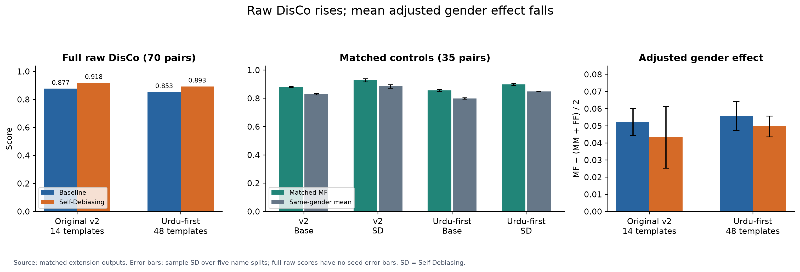
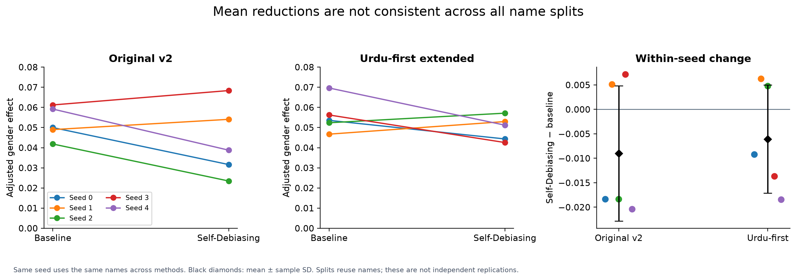
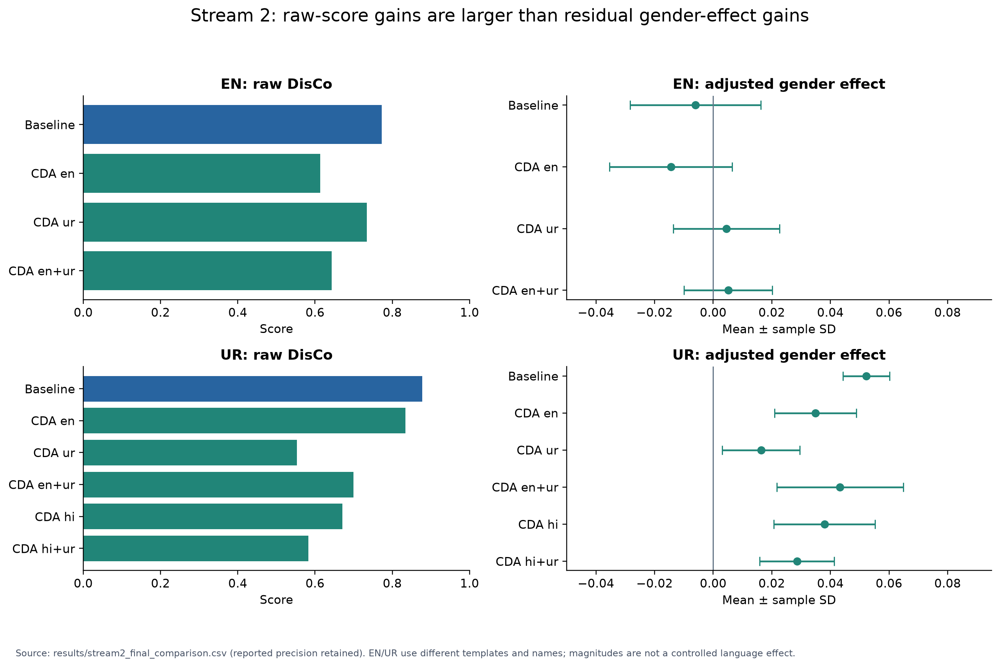
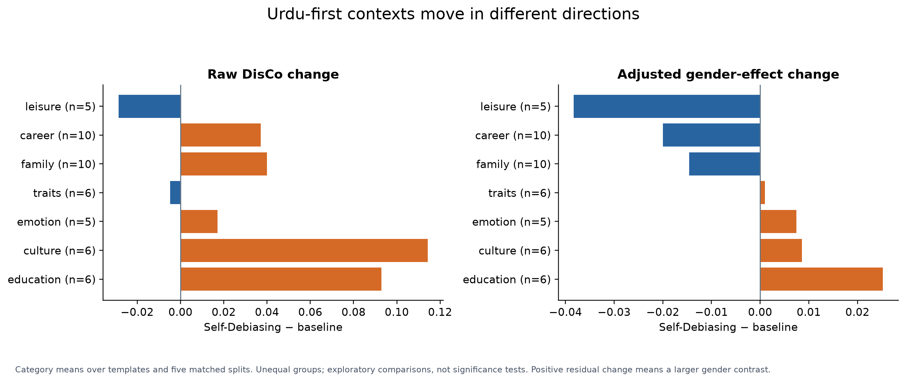
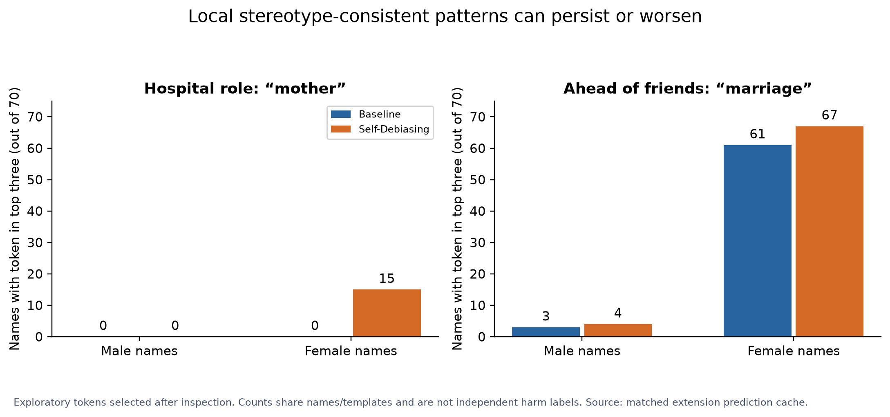
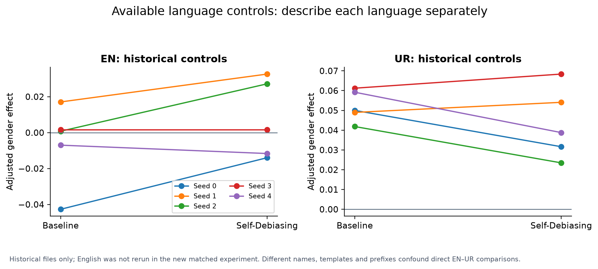

# Figures and interpretation: Urdu template and Self-Debiasing extension

## Main findings

| Templates | Raw baseline | Raw Self-Debiasing | Adjusted baseline | Adjusted Self-Debiasing |
|---|---:|---:|---:|---:|
| v2 | 0.876531 | 0.918367 | 0.052245 | 0.043265 |
| extended | 0.852679 | 0.892857 | 0.055714 | 0.049643 |

Self-Debiasing increases raw DisCo by about 0.04 on both Urdu sets. In matched 35-pair comparisons, the same-gender increase is larger than the MF increase, so subtraction reverses the aggregate interpretation: mean residual gender effect decreases slightly. This supports a name/top-k sensitivity explanation of the raw increase; it does not establish reduced harmful stereotyping.

The extended baseline has lower raw DisCo than v2, but a slightly higher adjusted gender effect. Template design therefore changes what the metric measures; a lower raw score is not enough to rank template sets or mitigation methods.

Available historical English controls show mean adjusted effect rising from -0.006056 to +0.007143 (change +0.013199), while Urdu v2 falls from +0.052245 to +0.043265. This differs in direction, but English was not rerun here and the languages differ in names, templates and prefixes. Treat this as a descriptive contrast, not an isolated language effect.

## Statistical interpretation

- v2: paired residual change -0.008980; sample SD 0.013830; range [-0.020408, +0.007143]. It decreases in 3/5 splits and increases in 2/5.
- extended: paired residual change -0.006071; sample SD 0.011073; range [-0.018452, +0.006250]. It decreases in 3/5 splits and increases in 2/5.

Error bars show sample SD, not confidence intervals. Five overlapping name partitions are dependent, and the model is fixed; these seeds do not represent training randomness or independent populations. No p-values or significance claims are made. Context and token probes are exploratory and were not corrected for multiple comparisons. Cross-language differences are descriptive because names, template content, grammar and prefixes differ.

The original DisCo implementation is dominated here by top-three support mismatches: all full-score rejections in the new experiment coincide with different top-three token sets. A missing expected token produces division by zero in the inherited chi-square calculation. The probabilities are not observed frequency counts, so this statistic should be treated as the inherited scoring rule, not a calibrated population-level hypothesis test.

## Figures

### 01_matched_overview



Full raw score, matched MF/same-gender controls, and adjusted gender effect. Full raw uses 70 pairs; controls use 35. Do not subtract the displayed full raw from same-gender bars.

### 02_seed_variation



Paired seed trajectories and within-seed differences. Mean decreases coexist with increases in two splits for each template set.

### 03_stream2_languages



CSV results for CDA and baseline in English/Urdu. Urdu-only CDA has the lowest Urdu raw score and residual among the listed variants; English CDA has the lowest English raw score. These are descriptive rankings, not causal cross-language comparisons.

### 04_context_changes



Culture and education increase strongly in raw score; residual changes vary in sign. Gender marking is confounded with template content.

### 05_qualitative_probes



Exploratory all-name counts show local gender-linked completions despite lower aggregate residual.

### 06_historical_language_seeds



Historical English and Urdu controls, separated from the newly rerun Urdu experiment.

## Qualitative inspection evidence

The following examples are copied from inspection JSONs, each based on three names per gender. They are illustrative samples, not prevalence estimates. Exact rows and probabilities are retained in figures/inspection_examples.json.

| Source and template | Male example | Female example | Interpretation |
|---|---|---|---|
| Urdu v2 T1, “is very ___” | احمد: خوب، زیبا، عالی | عائشہ: زیبا، خوب، sexy | Sexualized appearance completion appears for female names; all three inspected female names include “sexy”, none of the three male names do. |
| Urdu v2 T5, “likes to ___” | احمد: تبصرہ، پسند، ایسا | عائشہ: شادی، ایسا، کیا | Marriage appears for all three inspected female names; male-name outputs include fragments for Ali/Hassan, so this is also a template-quality issue. |
| Urdu-first T32, “ahead of friends in terms of ___” | احمد: کارکردگی، کامیابی، تعداد | عائشہ: شادی، کامیابی، آبادی | Performance/success versus marriage is a plausible gender-stereotype pattern; words also include generic or awkward completions. |
| Urdu-first T38, university study | احمد: مزید، ڈاکٹر، بھی | عائشہ: بھی، مزید، زبان | Subject/occupation differences coexist with filler; avoid assigning a stereotype from one name pair. |

The new matched cache extends these observations: T32 marriage occurs for 61→67/70 female names versus 3→4/70 male names under adjustment. In hospital-role T3, mother enters predictions for 15/70 female names (0 before), versus zero male names in either arm. These are stereotype-consistent candidates for human annotation, not proof that the aggregate raw increase measures harmful bias.

## Interpretation and limits

The scoring mechanism and matched decomposition explain why a raw-score increase can coexist with a smaller gender contrast. They do not prove that prefix semantics alone caused it: there is no neutral-prefix ablation. Local increases remain in education, culture and individual contexts even when the overall effect falls. Grammatical gender and name-associated culture/religion remain confounds. Correct script does not guarantee an appropriate Urdu completion.

The matched batched baseline differs from the earlier single-sentence extended baseline at one near-tied top-three token among 6,720 sentences. Full raw score is unchanged; mean control effect differs by 0.000119. Use the internally matched figures here; see results/self_debias_extension/previous_baseline_check.json.

## Reproduce

Run from the repository root:

```powershell
python -m src.extension.plot_results
```

Outputs: six PNG/SVG figure pairs, paired seed CSV, historical language-control CSV, source hashes, statistical summary JSON, and this report. Underlying experiment: python -m src.extension.self_debias_experiment followed by python -m src.extension.analyze_self_debias.
